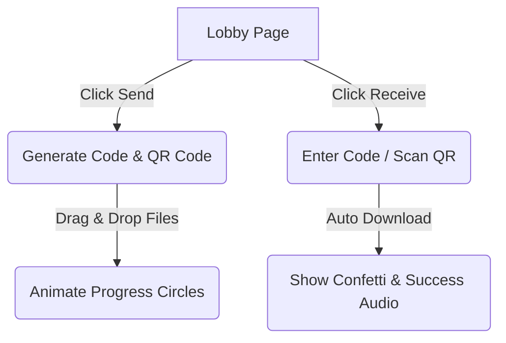

# 🚀 Direct Drop: Next-Level Roadmap & To-Do List

Welcome to the **Direct Drop** enhancement roadmap! Direct Drop is currently a solid, lightweight WebRTC file-sharing platform. To take it to the next level—matching or exceeding tools like Snapdrop, Sharedrop, or Wormhole—we can focus on four main pillars: **Core Stability & Fixes**, **UX/UI Polish**, **Advanced P2P Features**, and **Production Readiness**.

Below is a structured backlog of actionable tasks, grouped by complexity and impact.

---

## 🛠️ Phase 1: Critical Bug Fixes & Refactoring (Low Complexity, High Impact)

These are immediate code improvements that fix bugs or lay the groundwork for a more robust codebase.

### 1. Fix the Socket Context Crash Bug
* **Issue:** In [SocketContext.jsx](file:///home/shubham/Projects/directdrop/client/src/provider/SocketContext.jsx#L32), the error handler calls `setError(arg)`, but `setError` is not defined (it should be `setConnectionError`). This causes the client to crash whenever a WebSocket error is emitted.
* **Task:**
  - [ ] Modify `SocketContext.jsx` to correctly call `setConnectionError(arg)`.
  - [ ] Add a visual notification or toast to show error messages when they happen.

### 2. TypeScript Migration
* **Goal:** Migrating the client and/or server to TypeScript will make the WebRTC signaling logic, events, and component states self-documenting and prevent runtime reference errors.
* **Task:**
  - [ ] Add TypeScript packages to client (`typescript`, `@types/react`, etc.).
  - [ ] Rename `.jsx`/`.js` to `.tsx`/`.ts`.
  - [ ] Define explicit types/interfaces for:
    - WebRTC signaling packets (Offer, Answer, Candidates)
    - Batch and file metadata structures
    - Socket message structures

---

## 🎨 Phase 2: Premium UI/UX Polish (Medium Complexity, High Impact)

First impressions matter! Elevating the app's visual style and interaction design will make it feel like a premium, state-of-the-art product.



### 1. Modern Dark/Light Theme with Glassmorphism
* **Goal:** Create a stunning dark mode utilizing rich Tailwind v4 colors, smooth gradients, and glassmorphic panels (`backdrop-blur`).
* **Task:**
  - [ ] Implement a theme toggle state and save it in `localStorage`.
  - [ ] Add a dark theme configuration to `index.css` using CSS variables.
  - [ ] Use glowing borders for cards and subtle background gradient movement.

### 2. Drag & Drop File Zone with Motion Animations
* **Goal:** Replace the basic file input with a gorgeous interactive drop zone.
* **Task:**
  - [ ] Add a file drop overlay that triggers when dragging files anywhere over the screen.
  - [ ] Use `framer-motion` (Motion) to animate the drop area (e.g., pulsing borders, spring animations).
  - [ ] Support folder drops by parsing file entries recursively if possible.

### 3. QR Code Generator for Quick Sharing
* **Goal:** Entering a 4-digit code on mobile can be tedious. A QR code makes connection instant.
* **Task:**
  - [ ] Install `qrcode.react` or similar lightweight generator on the client.
  - [ ] Render a QR code next to the 4-digit code.
  - [ ] The QR code should encode a direct link: `https://<domain>/p2p/receive?code=1234`.
  - [ ] Automatically pre-fill the code field on the receiving side if the URL query parameter `code` is present.

### 4. Micro-Interactions, Audio, and Haptics
* **Goal:** Give sensory feedback to actions.
* **Task:**
  - [ ] Add light sound effects for:
    - Connection established 🔔
    - File transfer progress complete 🎉
    - Errors/Disconnections ⚠️
  - [ ] Add HTML5 vibration haptics (`navigator.vibrate`) for mobile users on connection/completion.

---

## ⚡ Phase 3: Advanced P2P Capabilities (High Complexity, High Impact)

These features optimize the core technology, allowing Direct Drop to transfer files faster, handle larger files, and automatically find local peers.

### 1. Local Network Auto-Discovery (IP-based Lobby)
* **Goal:** Like Snapdrop, users on the same Wi-Fi/local network should see each other automatically without typing codes.
* **Task:**
  - [ ] In [socketHandler.js](file:///home/shubham/Projects/directdrop/server/socketHandler.js), extract the client's public IP address from the request header (`socket.handshake.address` or custom headers like `x-forwarded-for`).
  - [ ] Group rooms or online users by their hashed public IP.
  - [ ] Send local clients a list of active peers on their same IP, allowing them to click a peer avatar to start a session.

### 2. Handle Large Files (OPFS / Stream Saving)
* **Problem:** Currently, the receiver app collects all file chunks in memory:
  ```javascript
  chunks.push(data); // in fileReceiver.js
  const blob = new Blob(chunks);
  ```
  If a user transfers a 4GB movie, the browser tab will run out of memory (RAM) and crash.
* **Solution:** Use the **Origin Private File System (OPFS)** or **File System Access API** to write chunks directly to disk as they arrive.
* **Task:**
  - [ ] Check for OPFS availability (`navigator.storage.getDirectory`).
  - [ ] Stream incoming buffer chunks directly to a writable stream using `FileSystemWritableFileStream`.
  - [ ] Fall back to standard memory array buffer only if OPFS is not supported (e.g., older browsers).

### 3. Connection Robustness (TURN Fallback)
* **Problem:** Standard STUN connections fail if both clients are behind symmetric NATs (e.g., office/university firewalls or strict cellular data).
* **Task:**
  - [ ] Integrate a TURN server setup in [createPeerConnection.js](file:///home/shubham/Projects/directdrop/client/src/webrtc/createPeerConnection.js).
  - [ ] Use a free tier cloud TURN provider (e.g., Metered.ca, Xirsys, or Twilio) or set up a self-hosted Coturn instance.

### 4. End-to-End Encryption (E2EE)
* **Goal:** Secure transfers against compromised signaling servers or network snooping.
* **Task:**
  - [ ] Before WebRTC data channel transfer begins, negotiate a symmetric key using Diffie-Hellman (ECDH) or generate a shared secret key via the 4-digit code.
  - [ ] Encrypt file chunks using the Web Crypto API (`crypto.subtle.encrypt` with AES-GCM) on the sender side before pushing to the data channel, and decrypt them on the receiver.

---

## 📦 Phase 4: Production & Deployment (Medium Complexity, Medium Impact)

Prepare the app for deployment, search indexing, and offline-first performance.

### 1. Progressive Web App (PWA) Support
* **Goal:** Allow users to install Direct Drop to their home screen and launch it like a native app.
* **Task:**
  - [ ] Add a `manifest.json` with icons and splash screens.
  - [ ] Register a service worker (using Vite PWA plugin) to cache static assets for offline use.
  - [ ] Register as a **Web Share Target** so users can click "Share" on any file in Android/iOS/Windows and choose Direct Drop directly.

### 2. SEO & Headless Analytics
* **Goal:** Improve search ranking and user metrics.
* **Task:**
  - [ ] Add semantic HTML, description tags, and open-graph images to `index.html`.
  - [ ] Add simple, privacy-focused client-side analytics (e.g., Plausible or self-hosted) to track successful transfers without violating user privacy.

---

## 🗺️ How to Choose What's Next?
If you'd like to proceed, tell me which phase or specific task you want to work on first, and we can draft an implementation plan! Here is the suggested path:
1. **Fix the socket bug** (10 mins)
2. **Add QR code sharing & query string support** (30 mins)
3. **Build the Dark Mode / glassmorphism theme** (45 mins)
4. **Implement local network auto-discovery** (60 mins)
